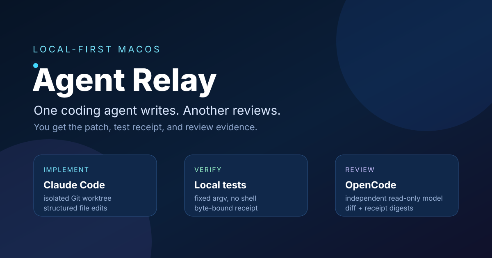
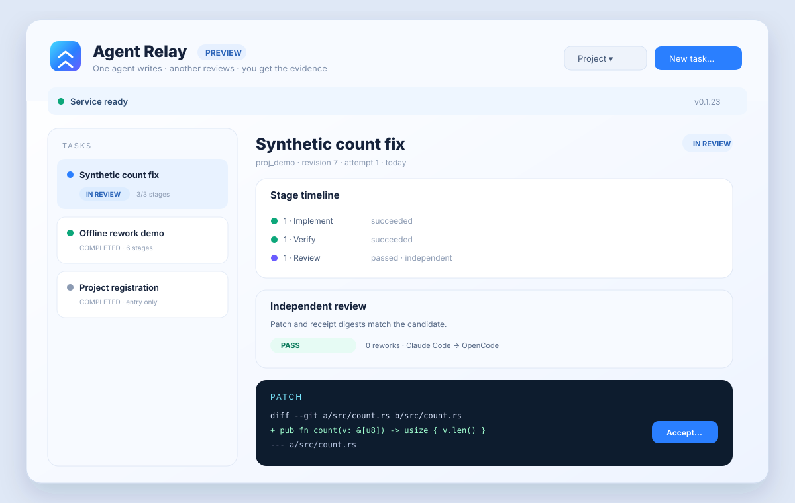
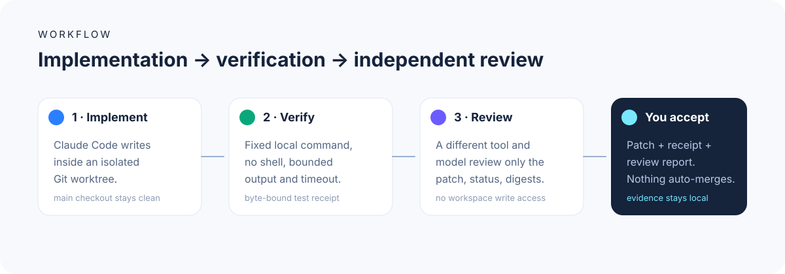

# Agent Relay

**One coding agent writes. Another reviews. You get the evidence.**

[English](README.md) · [简体中文](README.zh-CN.md)

[](LICENSE)
[](#requirements)
[](#architecture)
[](https://github.com/astralwaveorg/AgentRelayNext/actions/workflows/ci.yml)
[](docs/release-notes-0.1.23.md)



Agent Relay is a **local-first macOS app for two AI coding agents**. One agent implements
a change in an isolated Git worktree. A different tool and model review the exact patch
read-only. Relay runs your approved local tests, binds the evidence together, and asks you
to accept the result. Nothing is merged, pushed, or deployed automatically.

It is built for developers who already use two coding clients and are tired of copying
context, patches, and test output between them by hand.

## Why Agent Relay

- **Two independent roles.** A writer implements; a different tool/model reviews. Same
  model or same tool does not count as independent review.
- **Evidence, not a chat transcript.** You get the patch, the local test receipt, and the
  review report bound by SHA-256 to the same candidate.
- **Your checkout stays yours.** Implementation happens in a managed worktree; the main
  checkout's HEAD, index, and files are not modified.
- **Local by default.** The daemon, CLI, SwiftUI window, SQLite store, and MCP bridge all
  run on your Mac. No hosted relay service.



*Synthetic UI preview. No real project, account, or task data.*

## How it works



```text
Claude Code + MiniMax-M3.1-Flash  ── writes ──┐
                                              ▼
                              isolated Git worktree
                                              │
                              fixed local tests + receipt
                                              │
                                              ▼
OpenCode Go + GLM-5.3-Flash  ── read-only review of patch + receipt
                                              │
                                              ▼
                              patch + test receipt + review evidence
                                              │
                                              ▼
                                   you accept or reject
```

The default first-release route is intentionally fixed:

- implement with **Claude Code + MiniMax-M3.1-Flash**
- verify with an approved local command (no shell, fixed argv)
- review with **OpenCode Go + glm-5.3-flash**, read-only
- one task, one attempt, no automatic retry or fallback

The offline demo uses two local fake adapters and needs no account or network.

## Quick start

### 1. Download the DMG

Download `RelayTaskWindow-0.1.23.dmg` from the [latest GitHub Release](https://github.com/astralwaveorg/AgentRelayNext/releases/latest) and verify it:

```sh
shasum -a 256 RelayTaskWindow-0.1.23.dmg
```

The expected SHA-256 is listed in the release notes. The DMG is unsigned and not notarized:
on first launch, Control-click the app and choose **Open**, or allow it in
**System Settings → Privacy & Security**. Do not disable Gatekeeper globally.

### 2. Install

Open the DMG, drag `RelayTaskWindow.app` to `Applications`, and launch it.

### 3. Check the local service

```sh
relayctl="$HOME/Applications/RelayTaskWindow.app/Contents/Resources/relay/relayctl"
"$relayctl" doctor --instance-dir "$HOME/.agent-relay-next/instance"
"$relayctl" mcp-verify --socket "$HOME/.agent-relay-next/instance/relay.sock"
```

### 4. Try the offline demo

In the app, choose **Run offline demo**. It creates a synthetic task, runs implementation,
local verification, independent review, one rework, and manual acceptance. It does not
call a real model or read your project.

## Features

| Area | What you get |
| --- | --- |
| Orchestration | Task plan, submission, FIFO serial dispatch, one automatic rework, final human acceptance |
| Isolation | Managed detached Git worktree from a fixed commit OID; protected main checkout |
| Verification | Fixed executable/argv, no shell, cleared environment, bounded output and timeout |
| Independent review | Different tool and normalized model; read-only review input; digest-bound report |
| Evidence | Patch, test receipt, review report, usage events, stage timeline |
| Recovery | Persistent launch fence, dispatch gate, process-group reaping, interrupted-state recovery |
| Local control | Unix socket IPC, MCP stdio bridge, SwiftUI task window, menu bar panel |
| Operations | 2 GiB managed quota, 20-task queue cap, preview-first prune, 5 MiB × 5 log rotation |
| Model catalog | Versioned built-in entries and deterministic role recommendation |

## Architecture

```text
Host / Codex ── MCP stdio ──> relayctl mcp ── local Unix RPC ──┐
Shell ─────────────────────── relayctl ───────────────────────┤
SwiftUI window ───────────── local Unix RPC ──────────────────┤
                                                             ▼
                                                        relay daemon
                                                             │
                     ┌───────────────────────────────────────┼──────────────────────┐
                     ▼                                       ▼                      ▼
                  SQLite                                 managed worktree       verification
              plans/tasks/events                     detached Git checkout    fixed argv, no shell
              stage_runs/artifacts                   diff + receipt           process group
```

- **`relay-daemon`** is the only business writer and dispatcher.
- **`relay-store`** owns SQLite schema v9, idempotency, CAS state, launch fences, and stages.
- **`relay-git`** owns write-scope rules, worktrees, diffs, receipts, and atomic artifacts.
- **`relay-protocol`** defines the bounded local JSON-RPC framing and DTOs.
- **`relay-sys`** contains the small set of macOS process/socket/filesystem primitives.
- **`ui/RelayTaskWindow`** is the SwiftUI task window and menu bar UI.

See [Architecture](docs/architecture.md) for the detailed boundaries.

## Requirements

- macOS 14 or newer, Apple Silicon.
- Git available locally.
- Rust toolchain and Xcode Command Line Tools for source builds.
- For the real route: user-installed Claude Code and OpenCode, plus a native plan the user
  has verified. Relay does not download, install, or bundle vendor CLIs.
- The app and daemon run as the current user; no root or system daemon is required.

## Build from source

```sh
git clone git@github.com:astralwaveorg/AgentRelayNext.git
cd AgentRelayNext
./scripts/check full
packaging/package.sh "$PWD/dist"
```

`package.sh` creates an unsigned local preview ZIP. It is not a signed release artifact.
For a local DMG:

```sh
packaging/release/build-dmg.sh \
  "$PWD/dist/RelayTaskWindow.app" \
  "$PWD/dist/RelayTaskWindow-0.1.23.dmg"
```

## Data, privacy, and billing

- Default data directory: `~/.agent-relay-next/`; runtime directories are `0700`, files `0600`.
- One local Unix socket per instance; same-UID peers only. No HTTP/TCP/LAN listener.
- Supplier credentials are accepted through private stdin for a one-use worker; they are not
  written to argv, environment variables, logs, or persistent configuration.
- Review input contains only the goal, patch, verification status/rules, and digests; not the
  full workspace, terminal output, or user home.
- MiniMax charge attribution is recorded as `unverified`. OpenCode Go requires the provider's
  reported plan source and a zero balance charge. Relay does not infer account entitlements.
- No automatic account/model/route switching. Quota or permission uncertainty stops the run.

See [Security](SECURITY.md) and [Route pilot](docs/route-pilot.md).

## Status and scope

This repository is an **open-source developer preview**, not a signed production release.
The DMG is unsigned because the project has no Apple Developer ID/notarization identity.
Known gates are tracked in [Release notes](docs/release-notes-0.1.23.md) and
[Open-source readiness](docs/open-source-readiness.md).

Implemented: offline demo, fixed real-route preview/serve, StageRun persistence, managed
worktrees, verification receipts, independent review, human acceptance, queue/quota/prune
operations, model catalog, bilingual UI, and unsigned DMG builds.

Still limited: real-account end-to-end evidence, clean-user/second-UID/power-loss acceptance,
full accessibility/VoiceOver evidence, a full model marketplace, and continuous periodic
log rotation.

## Documentation

- [Architecture](docs/architecture.md)
- [Local preview and operations](docs/local-preview.md)
- [Project registration and real route](docs/project-registration.md)
- [Route qualification](docs/route-pilot.md)
- [Model catalog](docs/model-catalog.md)
- [Production package](docs/production-package.md)
- [GitHub unsigned DMG release](docs/github-release.md)
- [Release notes 0.1.23](docs/release-notes-0.1.23.md)
- [Open-source readiness](docs/open-source-readiness.md)

## Development

```sh
./scripts/check test relay-git
./scripts/check test relay-daemon
./scripts/check full
```

The full check runs `cargo fmt --all --check`, workspace Clippy with warnings denied, and
the workspace test suite. The UI is compiled with `packaging/build-app.sh`. Use
`Cargo.lock` and do not auto-update dependencies during a release.

## Contributing

Read [CONTRIBUTING.md](CONTRIBUTING.md). Security issues should follow
[SECURITY.md](SECURITY.md); do not open a public issue with exploit details or credentials.

## License

[MIT](LICENSE). Copyright (c) 2026 Agent Relay contributors.
