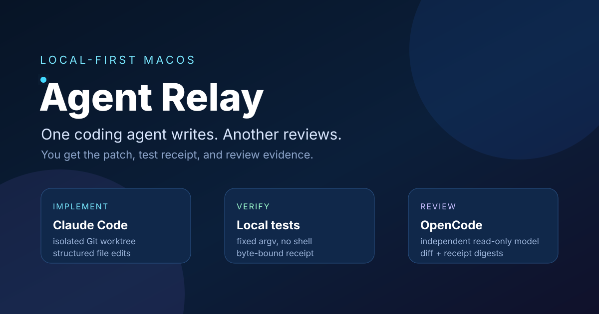
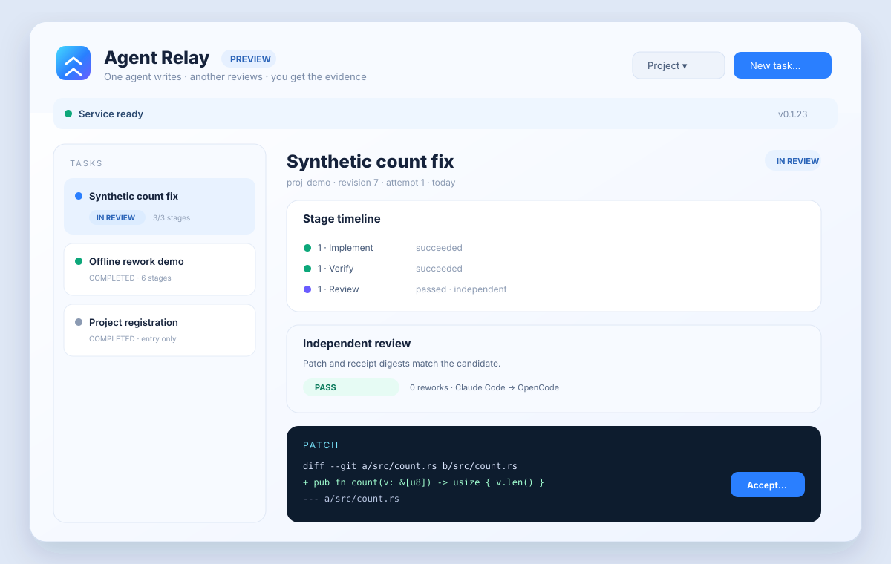

# Agent Relay

**一个编码 Agent 写，另一个独立评审，证据交给你。**

[English](README.md) · [简体中文](README.zh-CN.md)

[](LICENSE)
[](#环境要求)
[](#架构)
[](docs/release-notes-0.1.23.md)



Agent Relay 是一个**本地优先的 macOS 双 AI 编码工具**。一个 Agent 在隔离的 Git
worktree 中实现改动，另一个工具和模型只读评审同一份补丁；Relay 运行你批准的本地
测试，把补丁、收据和评审结论绑定在一起，最后交给你验收。它不会自动合并、推送或部署。

它面向已经同时使用两个编码客户端、但厌倦了手动复制上下文、补丁和测试结果的开发者。

## 为什么用它

- **两个独立角色。** 一个写，另一个评审；同一个工具或同一个模型不算独立评审。
- **给证据，不给聊天记录。** 补丁、测试收据、评审报告用 SHA-256 绑定到同一候选。
- **主工作树不动。** 实现发生在受管 worktree；主 checkout 的 HEAD、index 和文件不变。
- **默认本地。** daemon、CLI、SwiftUI 窗口、SQLite 和 MCP 桥都在这台 Mac 上，没有托管中转。



*合成 UI 预览，不包含真实项目、账户或任务数据。*

## 工作方式


```text
Claude Code + MiniMax-M3.1-Flash  ── 实现 ──┐
                                            ▼
                                  隔离 Git worktree
                                            │
                              固定本地测试 + 收据
                                            │
                                            ▼
OpenCode Go + GLM-5.3-Flash  ── 只读评审补丁 + 收据
                                            │
                                            ▼
                              补丁 + 测试收据 + 评审证据
                                            │
                                            ▼
                                     你验收或拒绝
```

首版真实路线固定为：

- **Claude Code + MiniMax-M3.1-Flash** 实现
- 批准的本地命令验证（固定 argv，不经 shell）
- **OpenCode Go + glm-5.3-flash** 独立只读评审
- 一个任务、一次 attempt、无自动重试或降级

离线演示使用两个本地 fake adapter，不需要账户或网络。

## 快速开始

### 1. 下载 DMG

从 GitHub Release 下载 `RelayTaskWindow-0.1.23.dmg`，核对摘要：

```sh
shasum -a 256 RelayTaskWindow-0.1.23.dmg
```

预期 SHA-256 写在 Release notes 中。DMG 未签名、未公证：首次启动请按住 Control 点击
App 选择“打开”，或到“系统设置 → 隐私与安全性”放行。不要全局关闭 Gatekeeper。

### 2. 安装

打开 DMG，把 `RelayTaskWindow.app` 拖到 `Applications`，然后启动。

### 3. 检查本地服务

```sh
relayctl="$HOME/Applications/RelayTaskWindow.app/Contents/Resources/relay/relayctl"
"$relayctl" doctor --instance-dir "$HOME/.agent-relay-next/instance"
"$relayctl" mcp-verify --socket "$HOME/.agent-relay-next/instance/relay.sock"
```

### 4. 运行离线演示

在窗口中选择“运行离线演示”。它会创建合成任务，完成实现、本地验证、独立评审、
一次返工和人工验收；不调用真实模型，也不读取你的项目。

## 功能

| 领域 | 内容 |
| --- | --- |
| 编排 | 计划、提交、串行派发、一次自动返工、最终人工验收 |
| 隔离 | 从固定 commit 创建 detached Git worktree；保护主 checkout |
| 验证 | 固定 executable/argv、无 shell、清空环境、有界输出和超时 |
| 独立评审 | 不同工具和归一化模型；只读输入；摘要绑定报告 |
| 证据 | 补丁、测试收据、评审报告、用量事件、阶段时间线 |
| 恢复 | 持久启动栅栏、派发门、进程组回收、中断恢复 |
| 本地控制 | Unix socket IPC、MCP stdio 桥、SwiftUI 任务窗口、菜单栏 |
| 运维 | 2 GiB 配额、20 任务队列上限、预览优先清理、5 MiB × 5 日志轮转 |
| 模型目录 | 版本化内置条目与确定性角色推荐 |

## 架构

```text
Host / Codex ── MCP stdio ──> relayctl mcp ── 本机 Unix RPC ──┐
Shell ─────────────────────── relayctl ───────────────────────┤
SwiftUI 窗口 ─────────────── 本机 Unix RPC ──────────────────┤
                                                             ▼
                                                        relay daemon
                                                             │
               ┌─────────────────────────────────────────────┼────────────────────┐
               ▼                                             ▼                    ▼
            SQLite                                      受管 worktree         本地验证
      plans/tasks/events                            detached Git checkout   固定 argv，无 shell
      stage_runs/artifacts                          diff + 收据             进程组监管
```

- **`relay-daemon`**：唯一业务写入和调度者。
- **`relay-store`**：SQLite schema v9、幂等、CAS 状态、启动栅栏和阶段。
- **`relay-git`**：写入范围、worktree、diff、收据和原子制品。
- **`relay-protocol`**：有界本机 JSON-RPC 帧和 DTO。
- **`relay-sys`**：少量 macOS 进程/socket/文件系统原语。
- **`ui/RelayTaskWindow`**：SwiftUI 任务窗口和菜单栏。

详见[架构说明](docs/architecture.md)。

## 环境要求

- macOS 14 或更高，Apple Silicon。
- 本机可用 Git。
- 源码构建需要 Rust 工具链和 Xcode Command Line Tools。
- 真实路线额外需要用户安装的 Claude Code、OpenCode，以及用户核对过的原生套餐。
  Relay 不下载、不安装、不捆绑厂商 CLI。
- 应用和 daemon 以当前用户运行，不需要 root 或系统守护进程。

## 从源码构建

```sh
git clone git@github.com:astralwaveorg/AgentRelayNext.git
cd AgentRelayNext
./scripts/check full
packaging/package.sh "$PWD/dist"
```

`package.sh` 生成未签名的本机预览 ZIP，不是正式签名产物。生成 DMG：

```sh
packaging/release/build-dmg.sh \
  "$PWD/dist/RelayTaskWindow.app" \
  "$PWD/dist/RelayTaskWindow-0.1.23.dmg"
```

## 数据、隐私和计费

- 默认数据目录：`~/.agent-relay-next/`；运行期目录 `0700`，文件 `0600`。
- 每个实例一个本机 Unix socket，只接受同 UID 对端；不开放 HTTP/TCP/LAN。
- 供应商密钥只通过私有 stdin 交给一次性 worker；不进入 argv、环境变量、日志或持久配置。
- 评审只接收目标、补丁、验证状态/规则和摘要；不发送完整工作区、终端输出或用户目录。
- MiniMax 扣费归属记为 `unverified`；OpenCode Go 要求供应商报告的套餐来源和零余额扣费。
  Relay 不推断账户权益。
- 不自动切换账户、模型或路线；额度/权限不确定时停止。

参见[安全策略](SECURITY.md)和[路线核验](docs/route-pilot.md)。

## 状态与范围

这是**开源开发预览**，不是签名生产版。因为没有 Apple 开发者身份，DMG 未签名、未公证。
已知门禁见[发布说明](docs/release-notes-0.1.23.md)和[开源准备清单](docs/open-source-readiness.md)。

已实现：离线演示、固定真实路线预览/启动、StageRun 持久化、受管 worktree、验证收据、
独立评审、人工验收、队列/配额/清理、模型目录、双语 UI 和未签名 DMG 构建。

仍有限：真实账户端到端证据、干净用户/第二 UID/断电验收、完整 VoiceOver/可访问性证据、
全市场模型目录，以及持续运行期间的定期日志轮转。

## 文档

- [架构说明](docs/architecture.md)
- [本机试用与运维](docs/local-preview.md)
- [项目登记与真实路线](docs/project-registration.md)
- [路线资格核验](docs/route-pilot.md)
- [模型目录](docs/model-catalog.md)
- [生产包准备](docs/production-package.md)
- [GitHub 未签名 DMG 发布](docs/github-release.md)
- [0.1.23 发布说明](docs/release-notes-0.1.23.md)
- [开源准备清单](docs/open-source-readiness.md)

## 开发

```sh
./scripts/check test relay-git
./scripts/check test relay-daemon
./scripts/check full
```

完整检查依次运行 `cargo fmt --all --check`、工作区 Clippy（警告视为错误）和工作区测试。
UI 用 `packaging/build-app.sh` 编译。发布使用 `Cargo.lock`，不自动更新依赖。

## 贡献

阅读 [CONTRIBUTING.md](CONTRIBUTING.md)。安全问题按 [SECURITY.md](SECURITY.md) 私下报告；
不要在公开 Issue 中放利用细节、凭据或任务数据。

## 许可证

[MIT](LICENSE)。Copyright (c) 2026 Agent Relay contributors。
