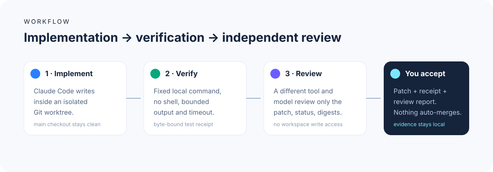

# Agent Relay

一个编码 Agent 写代码，另一个独立评审，把可核验的证据交给你。

[English](README.md) · [简体中文](README.zh-CN.md)

[](LICENSE)
[](#环境要求)
[](#架构)
[](https://github.com/astralwaveorg/AgentRelayNext/actions/workflows/ci.yml)
[](https://github.com/astralwaveorg/AgentRelayNext/releases/latest)


Agent Relay 是一个运行在 macOS 本机的双 AI 编码中继工具。它提供 MCP stdio 桥、CLI 和原生 SwiftUI 窗口。

每次任务按四步在本地执行：

1. 实现 Agent 在独立的 detached Git worktree 中修改代码。你的主工作区保持原样。
2. Relay 按固定 `argv` 执行你批准的本地测试命令，不经过 shell，并清空环境变量。测试结果保存为带摘要的收据。
3. 另一个工具和模型只读取这份补丁与测试收据，输出绑定双摘要的评审报告。
4. 你在 SwiftUI 窗口、CLI 或 MCP 客户端里查看补丁、收据和评审意见，再决定接受或拒绝。Relay 不会自动合并、推送或部署。

## 核心特点

- 独立评审。实现者和评审者必须使用不同工具，且归一化后的模型不同。provider 前缀和别名视为同一模型。
- 摘要绑定证据。`diff.patch`、`test_receipt.json` 和 `review.json` 通过 SHA-256 绑定到同一候选。评审后候选发生任何变化都会阻止交付。
- 主工作区不动。所有改动都在受管 worktree 中完成。主 checkout 的 `HEAD`、暂存区和文件不变。
- 本地无头守护进程。Rust 守护进程（`relayctl`）监听本机 Unix socket 并提供 MCP stdio 桥（`relayctl mcp`）。原生 SwiftUI 窗口负责任务查看和菜单栏状态展示。
- 失败关闭设计。运行时包含持久启动栅栏、派发门、有界进程组回收（先 `TERM` 后 `KILL`）、加固的 `/usr/bin/git` 调用、`0700`/`0600` 权限隔离，以及零网络监听。


*合成 UI 预览，不包含真实项目、账户或任务数据。*

## 工作流程



```text
Host / Codex / Shell ── MCP stdio / CLI / SwiftUI ──> relay daemon（本机 Unix socket）
                                                             │
              ┌──────────────────────────────────────────────┘
              ▼
   1. 实现（受管 Git worktree，写入路径白名单）
              │
              ▼
   2. 验证（固定本地测试命令，无 shell -> test_receipt.json + SHA-256）
              │
              ▼
   3. 评审（独立模型只读审查 diff + 收据 -> 摘要绑定评审报告）
              │
              ▼
   4. 验收（人工审阅证据并决定接受或拒绝）
```

## 快速开始

不需要 API Key，三分钟左右就能跑通完整离线演示。

### 1. 安装预览版 DMG

从 [GitHub Releases](https://github.com/astralwaveorg/AgentRelayNext/releases/latest) 下载 `RelayTaskWindow-<version>.dmg` 和 `SHA256SUMS`。核对校验和后，把 `RelayTaskWindow.app` 拖入 `Applications`：

```sh
shasum -a 256 -c SHA256SUMS --ignore-missing
```

> **未签名开发预览。** 本项目没有 Apple Developer ID，DMG 未签名也未公证。首次启动请按住 Control 点击 `RelayTaskWindow.app` 选择 **打开**，或在 **系统设置 → 隐私与安全性** 中点击“仍要打开”。不要全局关闭 Gatekeeper。

### 2. 启用本机服务

打开 **RelayTaskWindow** 后点击 **启用本地预览**，或在终端运行：

```sh
relayctl="$HOME/Applications/RelayTaskWindow.app/Contents/Resources/relay/relayctl"
"$relayctl" local-preview enable
"$relayctl" local-preview status
```

`enable` 会初始化 `~/.agent-relay-next/`，安装带日志轮转的包装脚本，注册当前用户 LaunchAgent，并自动执行 `doctor` 和 `mcp-verify`。随时可以运行 `local-preview disable` 停用服务并保留数据。

### 3. 运行离线演示

在任务窗口点击 **运行离线演示**。程序会用离线替身跑完一轮合成任务：实现、本地测试验证、独立评审、自动返工一轮和人工验收。全程不联网，不需要任何账户。

### 4. 接入 MCP 客户端（可选）

在 Codex、Claude Desktop 等支持 MCP 的客户端中加入本地 stdio 桥：

```json
{
  "mcpServers": {
    "agent-relay": {
      "command": "/Users/<你的用户名>/Applications/RelayTaskWindow.app/Contents/Resources/relay/relayctl",
      "args": ["mcp", "--socket", "/Users/<你的用户名>/.agent-relay-next/instance/relay.sock"]
    }
  }
}
```

升级、回滚、清理与排障见 [快速上手与运维指南](docs/getting-started.md)。在本地 Git 仓库使用真实模型见 [真实路线与项目登记](docs/real-routes.md)。

## 架构

```text
Host / Codex ── MCP stdio ──> relayctl mcp ── 本机 Unix RPC ──┐
Shell ─────────────────────── relayctl ───────────────────────┤
SwiftUI 窗口 ─────────────── 本机 Unix RPC ──────────────────┤
                                                             ▼
                                                        relay daemon
                                                             │
                    ┌────────────────────────────────────────┼──────────────────────┐
                    ▼                                        ▼                      ▼
                 SQLite                                受管 worktree             本地验证
           plans / tasks / events                  detached Git checkout    固定 argv，无 shell
           stage_runs / artifacts                   有界 diff + 测试收据       进程组监管回收
```

| 模块 | 职责 |
| --- | --- |
| `relay-core` | 纯状态机：合法状态转换、崩溃恢复分类、重试资格判定 |
| `relay-protocol` | 256 KiB 有界 JSON-RPC 2.0 帧解码、UTF-8 与重复键检查、DTO |
| `relay-store` | SQLite schema v9（WAL）、幂等去重、CAS 状态推进、启动栅栏、`stage_runs` |
| `relay-git` | 写入路径白名单、加固 `/usr/bin/git` 层、worktree、有界 diff、收据、原子制品 |
| `relay-daemon` | 单写入者调度核心、进程组回收、Unix IPC、MCP stdio 桥、CLI |
| `relay-sys` | 最小化 macOS/Unix 系统原语（`renamex_np`、`getpeereid`、`setpgid`/`killpg`、`statvfs`） |
| `ui/RelayTaskWindow` | 原生 SwiftUI 任务窗口、差异/收据/交付查看器、验收确认弹窗、菜单栏面板 |

详见 [架构与安全边界](docs/architecture.md)。

## 从源码构建

### 环境要求

- macOS 14 或更高版本，Apple Silicon
- Git、CI 固定版本的 Rust 工具链、Xcode Command Line Tools
- 使用真实路线时，需用户自行安装 Claude Code 和 OpenCode CLI（Relay 不下载也不捆绑厂商 CLI）

```sh
git clone https://github.com/astralwaveorg/AgentRelayNext.git
cd AgentRelayNext
./scripts/check full
packaging/package.sh "$PWD/dist"
```

## 当前状态与演进路线

Agent Relay `0.1.x` 是开源开发预览版。本机安全边界与审计底座已经就位，当前真实路线固定为一套双账户预览组合（`Claude Code + MiniMax` 实现，`OpenCode Go + DeepSeek` 只读评审，单轮结构化编辑，人工验收）。

`0.2` 到 `0.4` 的主要计划：

- 开放 BYOK 与多 CLI 适配（`v0.2`）。解耦供应商特化逻辑，支持标准 OpenAI/Anthropic 兼容 API、本地 Ollama，以及 Claude Code、Codex、OpenCode、Kimi Code、WorkBuddy 任意独立配对。
- 多轮 Worktree 编码与自动返工（`v0.3`）。允许实现 Agent 在隔离 worktree 内读仓、多轮修改并自跑测试，同时保留外层确定性验证与跨模型只读评审，开放自动返工循环。
- 一键落地交付与成本账本（`v0.4`）。支持将验收补丁应用到新本地分支、导出 Markdown PR 证据卡片，并统计多模型路由的成本节省。

完整分析和阶段计划见 [后续开发方案](docs/roadmap.md)。

## 文档导航

| 文档 | 内容 |
| --- | --- |
| [快速上手与运维指南](docs/getting-started.md) | 安装、一键启用与停用、离线演示、升级回滚、磁盘清理、日志与诊断 |
| [真实路线与项目登记](docs/real-routes.md) | 登记本机 Git 仓库、真实路线预览与启动、模型目录、重试与备用模型、计费与隐私 |
| [架构与安全边界](docs/architecture.md) | 模块职责、状态机、评审链与本机安全不变量 |
| [构建与发布流程](docs/release.md) | 未签名 DMG 打包、SBOM、资产校验、原生 smoke 与 GitHub Release 流程 |
| [后续开发方案](docs/roadmap.md) | 市场分析、现状诊断与 `v0.1.28` 到 `v1.0` 开发规划 |
| [真实运行脱敏证据](docs/evidence/README.md) | 真实双账户合成验收的脱敏证据包与生成规则 |

其他文件：[CHANGELOG.md](CHANGELOG.md)、[CONTRIBUTING.md](CONTRIBUTING.md)、[SECURITY.md](SECURITY.md)、[SUPPORT.md](SUPPORT.md)。

## 许可证

[MIT](LICENSE) © 2026 Agent Relay contributors.
